

  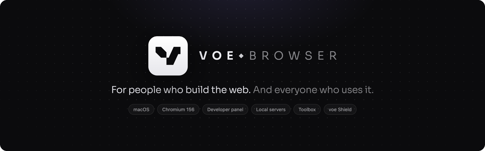

  <a href="README.md">Türkçe</a> · <b>English</b>

  
  
  
  
  

  <a href="https://github.com/dev-cagri/voe/releases/latest/download/voe-mac-arm64.dmg"><b>Download for macOS</b></a>
  &nbsp;·&nbsp; <a href="#voe-mobile">iOS (TestFlight)</a>
  &nbsp;·&nbsp; <a href="https://github.com/dev-cagri/voe/releases">All releases</a>
  &nbsp;·&nbsp; <a href="https://github.com/dev-cagri/voe/issues/new/choose">Feedback</a>

 

**voe** is a calm, fast, Chromium-based browser for macOS. It keeps everyday browsing quiet, and it puts the tools web developers reach for all day one click away inside the browser: device emulation, console errors, local dev servers, a JSON viewer and an offline toolbox. The **voe Shield** ad and tracker blocker is always on. If you want, **voe AI** translates, summarizes and chats entirely on your Mac. The interface is in Turkish.

  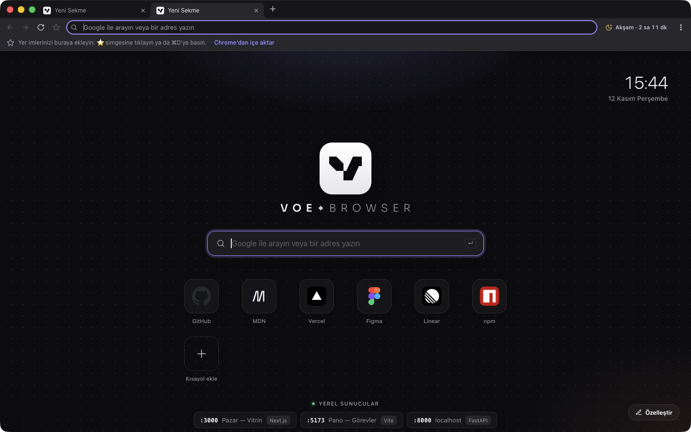

> [!NOTE]
> This repository hosts voe’s **releases, release notes and feedback**. voe is free; its source code is not public.

---

## For developers

<table>
  <tr>
    <td width="50%" valign="top">
      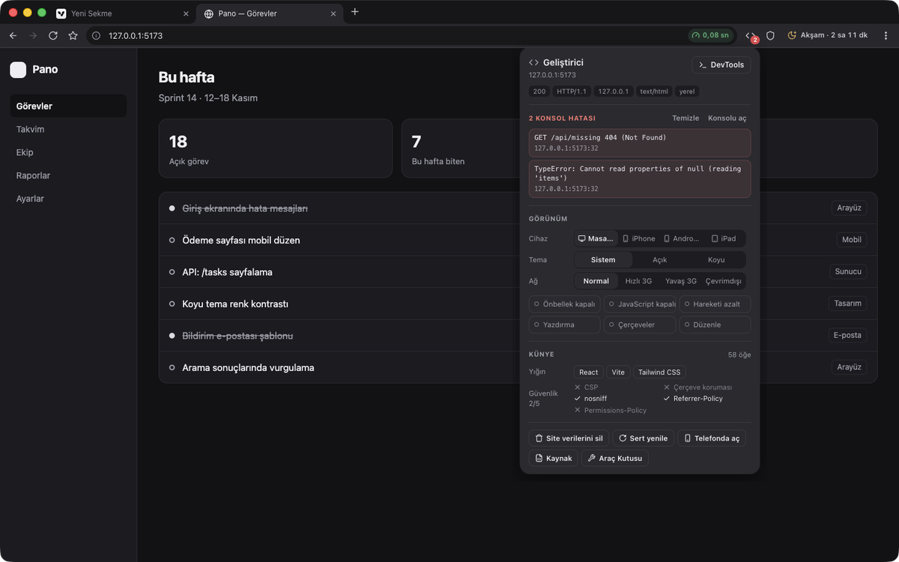
      <h3>Developer panel <code>⇧⌘E</code></h3>
      The <code>&lt;/&gt;</code> button in the toolbar opens a panel for each tab. It lists the page’s console errors. It also shows the frameworks in use (React, Next.js, Vue, Svelte, Astro, Vite, Tailwind…), the server and hosting (Cloudflare, Vercel, Netlify…), the HTTP status and protocol, and a checklist of security headers (HSTS, CSP, frame protection, nosniff…).
    </td>
    <td width="50%" valign="top">
      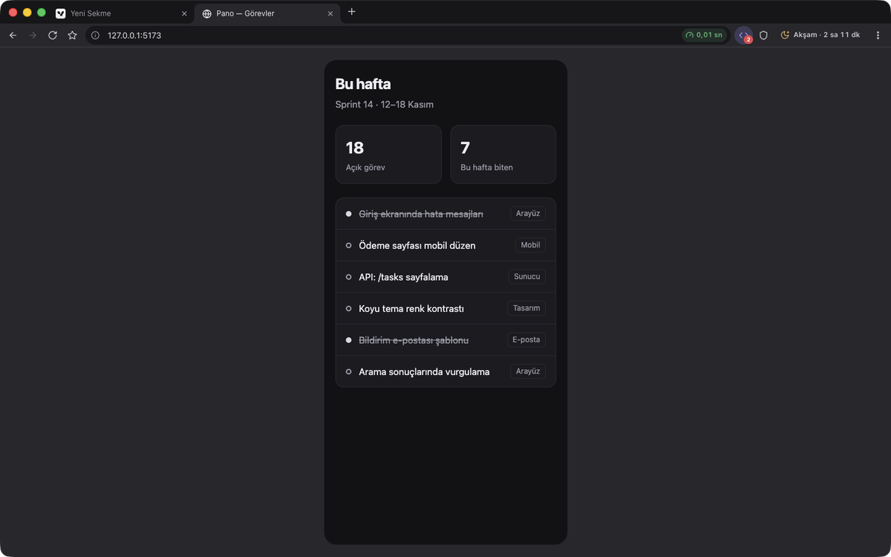
      <h3>Device and network emulation <code>⇧⌘M</code></h3>
      Switch to iPhone, Pixel or iPad in one click. The page view really shrinks to that width and is centred. The user agent, touch input and pixel ratio change too, and you can rotate the view. You can pick a light or dark color scheme, or Fast 3G, Slow 3G or offline networking. Switches turn off the cache or JavaScript, reduce motion, show the print view, outline every element, or let you edit the page in place. Everything is per tab and leaves no trace once turned off.
    </td>
  </tr>
  <tr>
    <td width="50%" valign="top">
      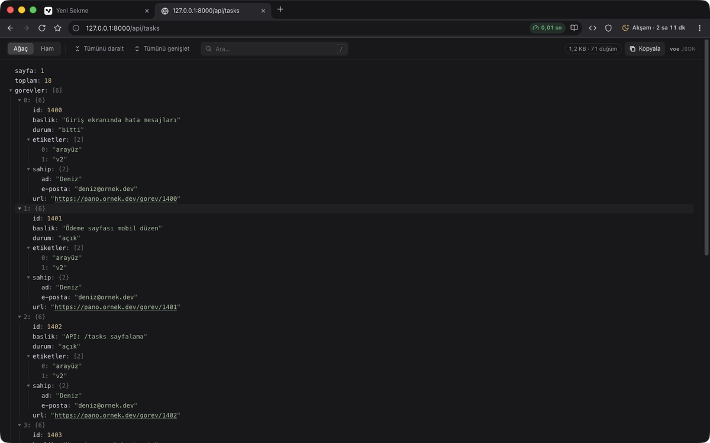
      <h3>JSON viewer</h3>
      API responses open as a collapsible, searchable tree; even a 10 MB document appears instantly. Clicking a key copies its path (<code>data.items[3].name</code>). Big integers keep every digit, and the raw view is one click away.
    </td>
    <td width="50%" valign="top">
      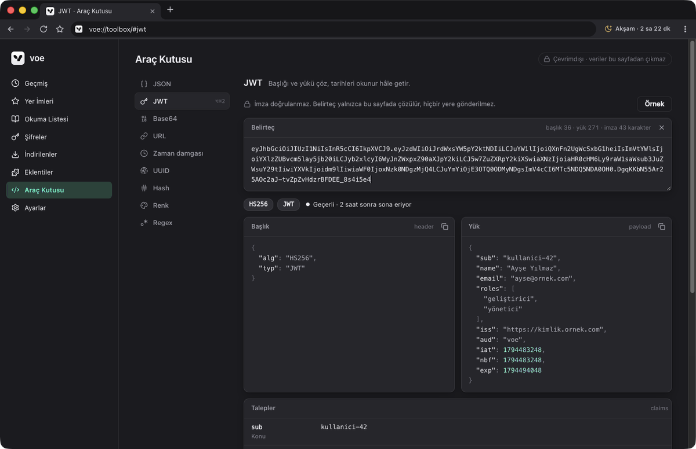
      <h3>Toolbox <code>⌥⌘T</code></h3>
      <code>voe://toolbox</code> has nine tools: format and validate JSON, decode JWTs, Base64, URL encoding and parsing, Unix timestamps, UUID v4/v7, hashes (SHA, MD5, HMAC), color conversion with WCAG contrast, and a regex tester. Everything runs offline; a pasted token never leaves the page.
    </td>
  </tr>
</table>

- **Local servers.** voe finds the dev servers running on your Mac on its own: Vite, Next.js, Nuxt, Astro, SvelteKit, Angular, Storybook, Django, Flask, FastAPI, Rails, Laravel, Express… It lists them with their page titles on the new tab page, in the address bar (type `local` or `:5173`) and in the command palette.
- **Test on your phone.** Press the QR button on a `localhost` page: the address is rewritten to your Mac’s LAN IP, so a phone on the same Wi-Fi opens it. If the server only listens on localhost, voe notices and shows the fix, such as `vite --host`.
- **Error count.** On local development pages, a red count appears on the `</>` button when the page throws JavaScript errors.
- **One-click cleanup.** “Clear site data” deletes the site’s cookies, storage and service workers, then reloads the page. A hard reload and the page source are one click away too.
- **Full Chromium DevTools** is always available with `⌥⌘I`.

## Privacy: what you look at is your business

On an ordinary browser, your internet provider and anyone on your network can see which sites you visit. voe closes that off by default:

- **Encrypted DNS (DNS-over-HTTPS).** Site names are looked up over an encrypted channel. **Strict mode** never falls back to plain DNS. You can pick Cloudflare, Quad9, Mullvad, AdGuard or your own server.
- **Encrypted site name (ECH).** On sites that support it, even the domain at the start of the secure connection stays hidden.
- **HTTPS first.** Addresses always open over an encrypted connection. If a site can’t do HTTPS, voe asks before continuing.
- **Your data is encrypted on disk.** History, bookmarks, the reading list, sessions and passwords are stored with AES-256-GCM, and the key lives in the macOS Keychain.
- **Tracker blocking, GPC and WebRTC protection.** voe Shield stops trackers. Sites receive a “don’t sell my data” signal, and your local IP address doesn’t leak.
- **Privacy check.** One button in Settings verifies all of this live.

## Sync: end-to-end encrypted, no account

Bookmarks (with folders), passwords, history, open tabs, the reading list and settings stay in sync across **multiple devices** — your phone and as many Macs as you like. There’s no account or email. To pair, show the QR code on the **Senkron** page of one device and read it on the other: the phone uses its camera, a new Mac uses Senkron → **Kamerayla tara** (Scan with camera). If you can’t use a camera, copy and paste the pairing link instead.

Every record is encrypted on the device with **AES-256-GCM**. The server only sees meaningless encrypted blobs and can’t read URLs, titles or passwords. The key exists only on your devices. **Reset sync** cuts off a lost device in one step.

## Page translation: fast and on device

  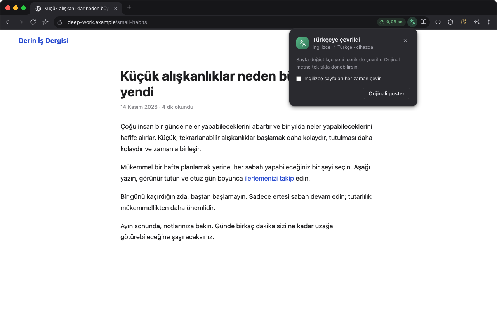

- **Like Chrome.** When a page in another language opens, the translate bubble appears on its own: press **Translate to Turkish**. There is also a translate button in the address bar and right-click → **Translate to Turkish**. What you see on screen is translated first; the whole page is Turkish within seconds. On pages whose interface is Turkish but some parts are not, only the foreign parts are translated.
- **Fast.** Instead of a large AI model, it uses small neural models built for translation: hundreds of words per second.
- **On this Mac.** Translation runs on the device and the page text is never sent anywhere. The first time, a 15–40 MB model per language downloads once. The models are the ones Mozilla publishes for Firefox translation (MPL-2.0). English is translated directly; German, French, Spanish, Russian, Arabic, Japanese and 20+ other languages go through English.
- **The page keeps working.** Links, buttons and formatting stay in place; code blocks are not translated. Content that loads later is translated too. **Show original** brings everything back.
- **See it in Turkish right away.** Tick “always translate … pages” in the bubble and pages in that language open already in Turkish. For a language you don’t want, choose “never translate”. Managed in Settings › Page translation.

## Files and notes

  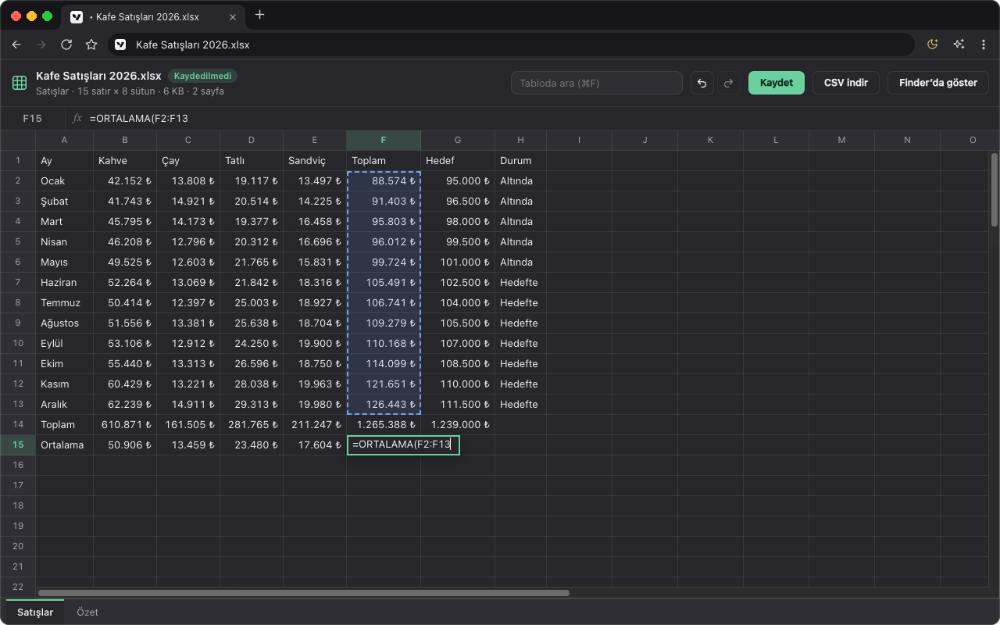

- **Open, edit and save Excel files.** Drop xlsx, xls, ODS, CSV or Numbers files on the tab strip or pick them with `⌘O`. Start typing in a cell and enter formulas in English or Turkish (`=SUM` / `=TOPLA`, `=IF` / `=EĞER`). While typing a formula, clicking or dragging over cells inserts the reference.
- **Formatting stays intact.** When you save with `⌘S`, only the changed cells are written to xlsx. Formatting, tables, charts and macros are kept as they are, and the original file is backed up before the first save.

  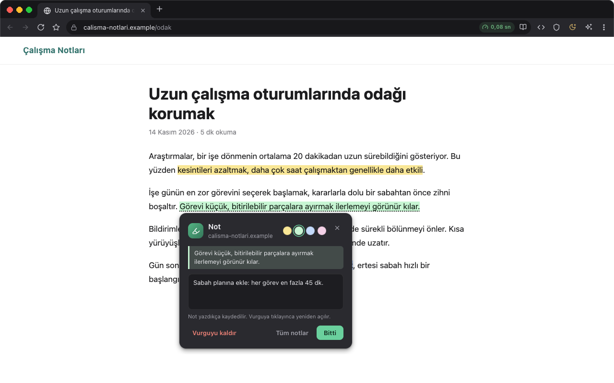

- **Highlight and take notes.** Select text on a page, right-click → **Highlight** (`⇧⌘H`). Click a highlight to open its note card; what you type is saved automatically. Four colors.
- **Still there when you come back.** Highlights reappear when you reopen the page. The page’s markup is never changed, and it works with content that loads later.
- **All in one place.** All your notes are on `voe://notes` and in the **My notes** card on the new tab. Click a note to open the page at that line. Export as Markdown; stored encrypted on disk. Nothing is highlighted in private windows.

## voe AI: AI that runs on this Mac

  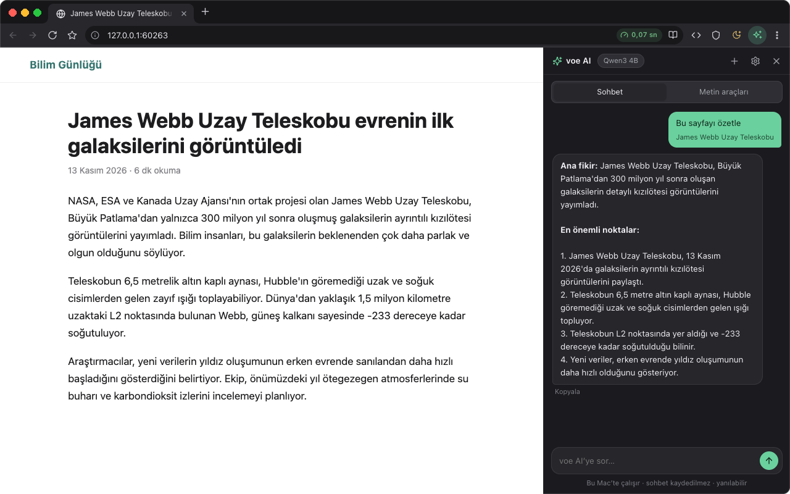

voe AI is **optional**. Nothing is downloaded unless you install it. You can install it from the voe AI card on the new tab or the ✦ button in the toolbar.

- **Side panel** (`⌥⌘A` or ✦): chat, ask it to **summarize this page**, then ask follow-up questions about the page. The text tools translate, summarize, explain and fix spelling.
- **Selected text** → right-click → **voe AI**: translate into Turkish or English, summarize, explain, fix spelling. The result streams next to the selection. In editable fields, **Yerine yaz** (Replace) swaps the text in one click.
- **Entirely on device.** The model and engine ([WebLLM](https://github.com/mlc-ai/web-llm)) run on your Mac’s GPU (WebGPU). What you type, the answers and page text never go to a server and are not saved. Only the model files download, once, from the MLC repository on Hugging Face. After that it works offline. The engine shuts down after 5 idle minutes and frees its memory.
- **Models:** Qwen3 4B (recommended, 2.3 GB, ~3.4 GB memory while running) or Gemma 2 2B (light, 1.5 GB). Switch or remove them from the panel’s Model section.
- Needs Apple Silicon and about 4 GB of free disk. Small models can be wrong, so double-check anything important. It has no internet access and doesn’t know current events.

## For every day

| | |
|---|---|
| **voe Shield** | Blocks ads and trackers, hides cookie notices, can be turned off per site, stats on the new tab page |
| **Command palette** `⌘K` | Tabs, commands, bookmarks and history in one box; search ignores Turkish accents |
| **Tabs** | Live Chrome-style dragging (detach, merge into another window), colored tab groups, split view `⌥⌘S` |
| **Tab sleeping** | Unused tabs release their memory and come back exactly where they were |
| **Reading** | Reader mode `⌥⌘R` and an offline reading list `⇧⌘D` |
| **Focus session** | During a Pomodoro, distracting sites wait on a calm page |
| **Send to phone** | The page’s QR code is generated on your Mac; scan it with voe mobile or the camera |
| **Screenshots** | `⇧⌘2` visible area, `⌥⇧⌘2` full page |
| **Passwords** | Encrypted with the macOS Keychain, autofill, reveal with Touch ID |
| **Extensions** | Install from the Chrome Web Store |
| **Speed meter** | Page load time in the address bar, with a DNS-to-download breakdown |
| **New tab cards** | Up to four cards in a single row: markets, multi-city weather, news (RSS), recent earthquakes, prayer times, world clocks, calendar, countdown, notes, to-dos, reading list and site links; drag to reorder |
| **Import from another browser** | Bookmarks, passwords, saved cards, addresses and history from Chrome, Edge, Brave, Vivaldi, Opera and Chromium in one step — everything stays on your device |
| **Vakit** | Next prayer time, Hijri date and a tasbih counter (computed on device). The button is dynamic: the countdown starts an hour before. Can be turned off in Settings |
| **Web notifications** | Sites ask for permission and your choice is remembered; clicking a notification brings its tab forward |
| **Downloads** | Drag a finished file from the list to Finder, the desktop or a website |
| **WhatsApp** | The WhatsApp button in the toolbar opens WhatsApp Web in a side panel next to the page. It keeps running in the background when the panel is closed: notifications arrive and the unread count shows on the button and in the Dock. Links in chats open in a new tab |
| **Media controls** | When music or video plays in a tab, a toolbar button appears: media from all tabs with artwork, title and a progress bar; play/pause, previous/next track, 10 s back/forward, mute, go to tab. Switching tabs moves a playing video into picture-in-picture automatically |
| **Customizable toolbar** | Hide any button in Settings › Toolbar or by right-clicking it › “Hide” |
| **Page translation** | Translate pages into Turkish in one click; on device and fast. Right-click, the ⋮ menu or the button in the address bar; “always translate” option |
| **Notes and highlights** | Select text → right-click → Highlight (`⇧⌘H`); click a highlight to add a note. All of them on `voe://notes` and in the “My notes” card on the new tab; export as Markdown |
| **Clear site data** | If a site misbehaves, clear only that site’s cookies, storage and cache (subdomains included) from the lock in the address bar or the ⋮ menu. Per-site cookie list in Settings |
| **Open files** | Drag from Finder onto the tab strip, press `⌘O` or use “Open With → voe”: PDF viewer; a spreadsheet editor for Excel (xlsx, xls), ODS, CSV and Numbers |
| **Spreadsheet editing** | Type into cells, enter formulas (English or Turkish function names, e.g. `=SUM(B2:B9)` / `=TOPLA(B2:B9)`), click cells while typing a formula to insert references; dependent formulas recalculate instantly. Undo/redo, cut/copy/paste (also from Excel), save with `⌘S`. For xlsx only the changed cells are written, so formatting, tables, charts and macros are kept, and the original file is backed up before the first save. CSV keeps its delimiter and encoding; xls/ODS/Numbers are saved as .xlsx |

## voe mobile

  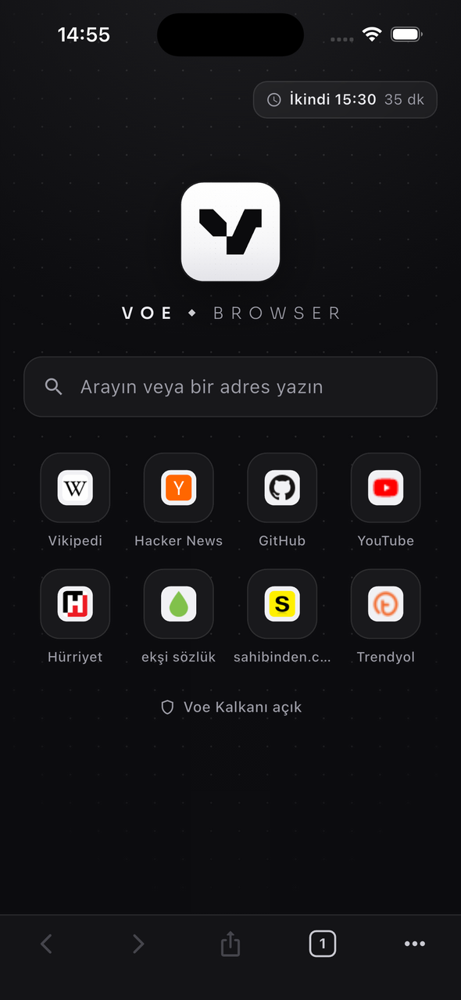
  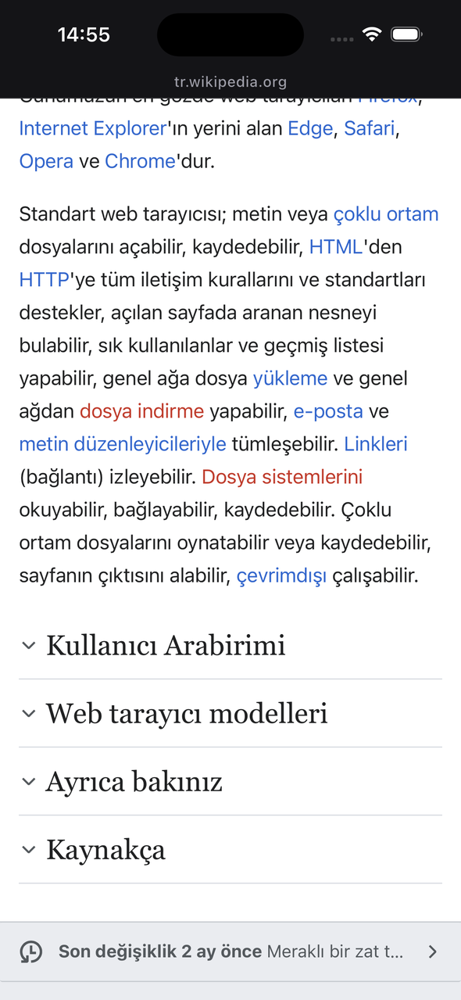
  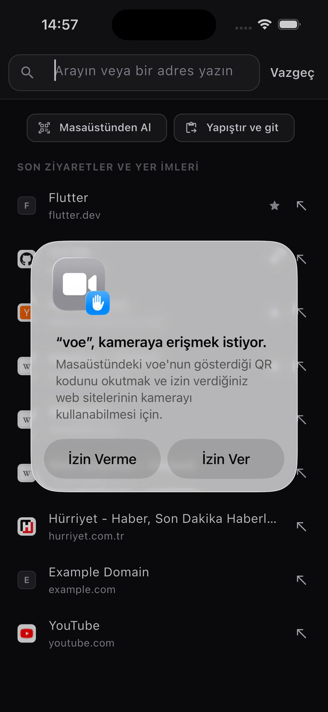
  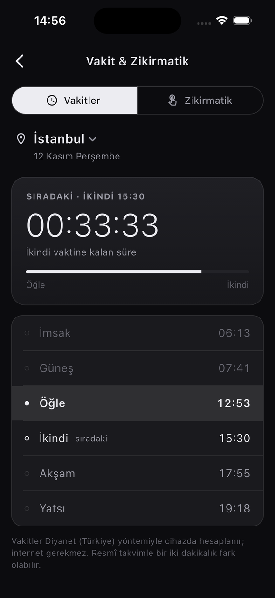

The iOS app is in **TestFlight** beta, and Android is on the way. It shares the same minimal design as the desktop app:
- The address bar is on top, and the toolbars slide away while you scroll.
- It has a tab grid and private tabs.
- voe Shield and reader mode are built in.
- “Masaüstünden Al” scans the QR code from the desktop “Send to phone” button and opens the page.

## Installation

1. Download **[voe-mac-arm64.dmg](https://github.com/dev-cagri/voe/releases/latest/download/voe-mac-arm64.dmg)**, open it and drag **voe** into **Applications**.
2. voe is signed with an Apple Developer ID and **notarized by Apple**; on first launch macOS only asks whether to open an app downloaded from the internet.
3. You can make voe your default browser with the **Varsayılan tarayıcı yap** (Make default browser) button at the top of Settings, or in System Settings › Desktop & Dock › Default web browser. Links from other apps and `.html` files then open in voe. Bookmarks, passwords, saved cards, addresses and history from Chrome, Edge, Brave and other browsers import in one step from **⋮ → Tarayıcıdan İçe Aktar…** (Import from browser); everything stays on your device.

**Requirements:** macOS 12 Monterey or later on Apple Silicon (M1 or newer).

## Updates

voe checks this repository’s [latest release](https://github.com/dev-cagri/voe/releases/latest) at launch and every 6 hours. The request carries only the app version.

Starting with 0.2.11, updates install themselves. The new version’s `.zip` package downloads in the background. It is checked against the SHA-256 digest GitHub publishes, and then the macOS updater confirms it carries the same developer signature. It installs when you restart voe (or quit and reopen it), and your open tabs come back. If voe is opened from the disk image (`.dmg`) or Downloads it can’t update itself; since 0.5.1 it notices this and offers to **move itself to the Applications folder** in one click and relaunch. If the copy in Applications is newer, it opens that one instead.

Coming from 0.2.10 or earlier, install the `.dmg` once by hand. Automatic download and the check can each be turned off in **Ayarlar → Güncellemeler** (Settings → Updates).

## Keyboard shortcuts

| Shortcut | Action | Shortcut | Action |
|---|---|---|---|
| `⌘K` | Command palette | `⇧⌘E` | Developer panel |
| `⌘L` | Address bar | `⇧⌘M` | Toggle iPhone emulation |
| `⇧⌘T` | Reopen closed tab | `⌥⌘T` | Toolbox |
| `⌥⌘S` | Split view | `⌥⌘I` | Chromium DevTools |
| `⇧⌘F` | Focus mode | `⌥⌘U` | View source |
| `⌥⌘R` | Reader mode | `⇧⌘R` | Reload ignoring cache |
| `⇧⌘D` | Add to reading list | `⇧⌘2` / `⌥⇧⌘2` | Screenshot / full page |
| `⌥⌘A` | voe AI panel | `⌘O` | Open a file (PDF, Excel, CSV…) |
| `⇧⌘H` | Highlight the selected text | | |

## Data and telemetry

- No telemetry: no usage statistics, crash reports or advertising IDs.
- Your data stays on your devices. With sync on, only end-to-end encrypted records reach the server.
- The local-server scan, Toolbox, JSON viewer, QR codes and voe AI run entirely on your device.
- voe makes only three connections on its own: Shield filter-list updates, site icons for bookmarks, and the update check. The update check goes to GitHub, carries only the version and can be turned off. When a new version exists, its package also downloads from GitHub. If you install voe AI, the model files download once from Hugging Face; nothing you type is sent anywhere. When you translate a page, that language’s translation model downloads once from Mozilla’s public model storage; the page text is never sent.

## Feedback

Found a bug or have an idea? [Open an issue](https://github.com/dev-cagri/voe/issues/new/choose). For bugs, please include your voe version (**⋮ → voe Hakkında**) and macOS version. Issues in English are welcome.

## License

voe is free; its source code is not public. See [LICENSE](LICENSE) for details. voe builds on open-source projects, each under its own license: [Electron](https://www.electronjs.org/) and Chromium (MIT/BSD), [Ghostery adblocker](https://github.com/ghostery/adblocker) (MPL-2.0), [Mozilla Readability](https://github.com/mozilla/readability) (Apache-2.0), [electron-chrome-extensions](https://github.com/samuelmaddock/electron-browser-shell) (MIT), [adhan-js](https://github.com/batoulapps/adhan-js) (MIT), [qrcode-generator](https://github.com/kazuhikoarase/qrcode-generator) (MIT), [WebLLM](https://github.com/mlc-ai/web-llm) (Apache-2.0), [SheetJS](https://sheetjs.com) (Apache-2.0) and [Sora](https://github.com/sora-xor/sora-font) (OFL-1.1). voe AI models are downloaded separately: [Qwen3](https://huggingface.co/Qwen/Qwen3-4B) (Apache-2.0), [Gemma 2](https://ai.google.dev/gemma/terms) (Gemma Terms of Use).

© 2026 voe

