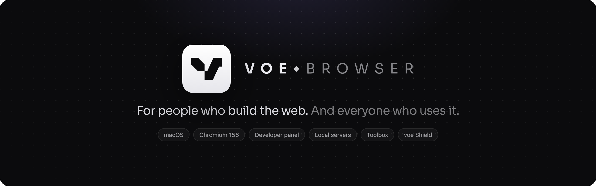
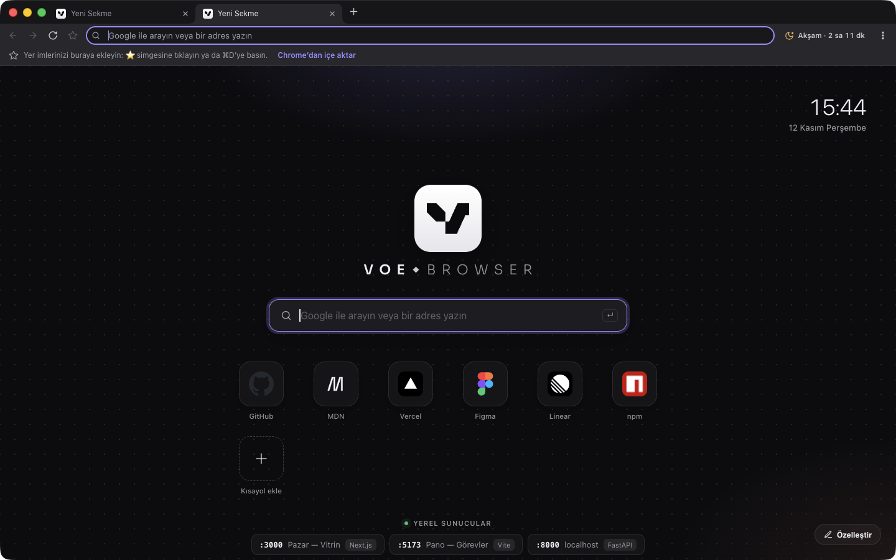
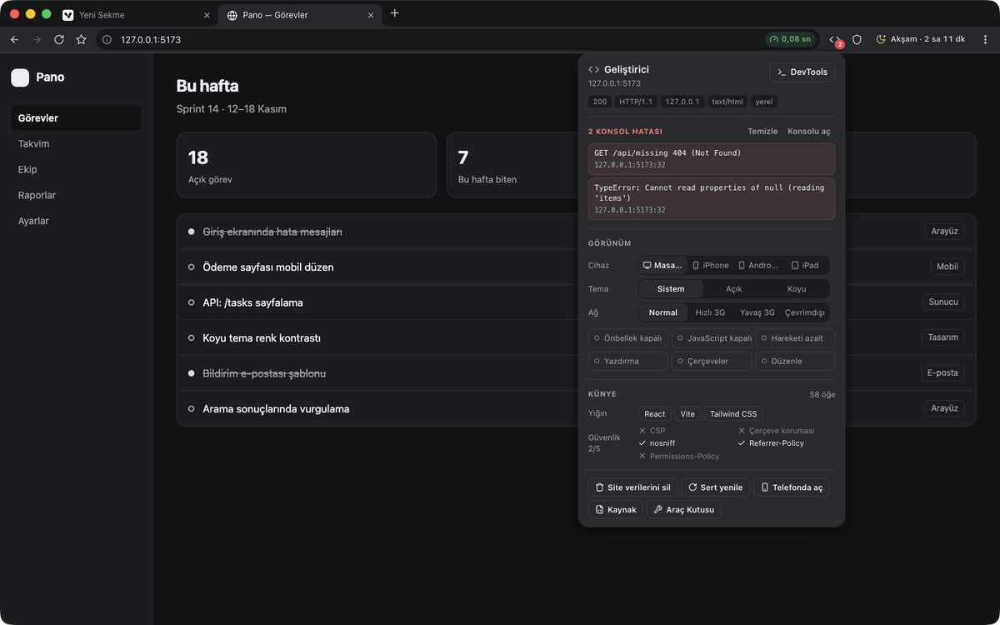
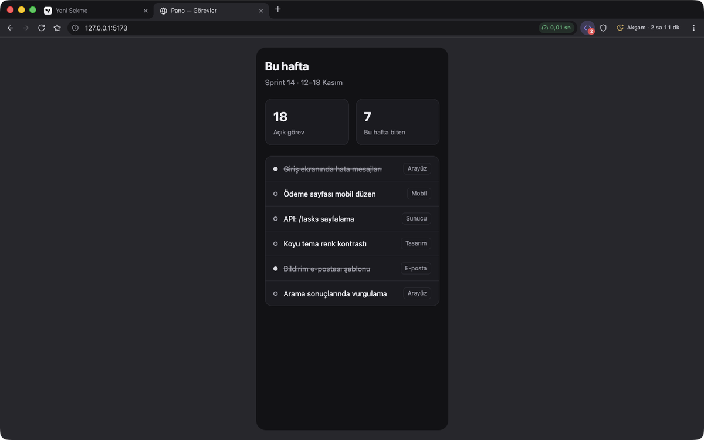
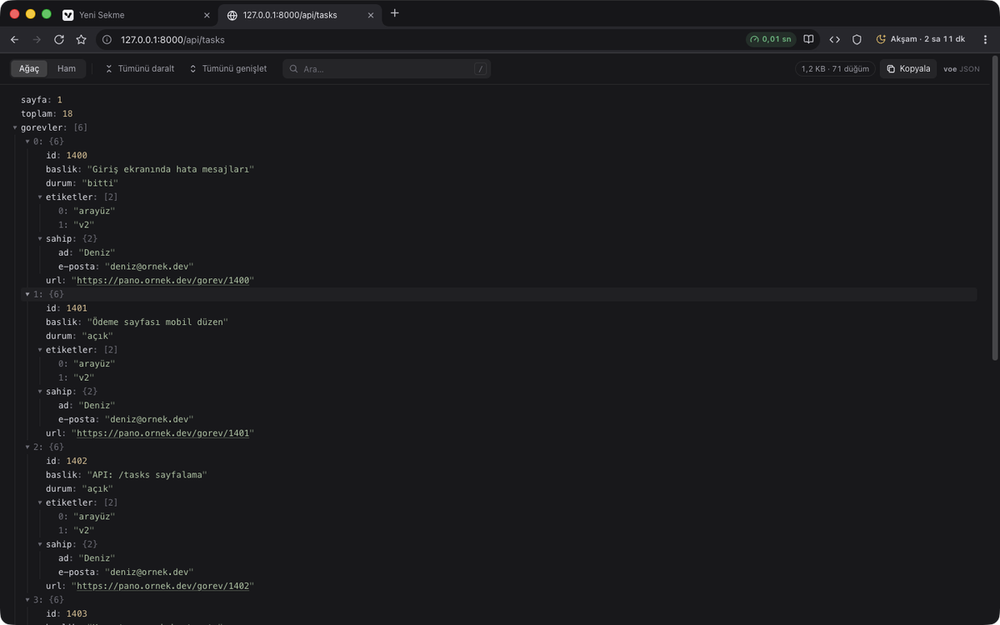
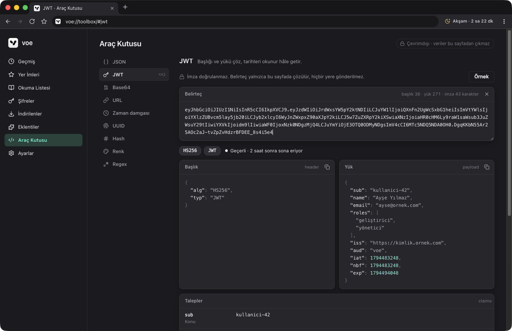
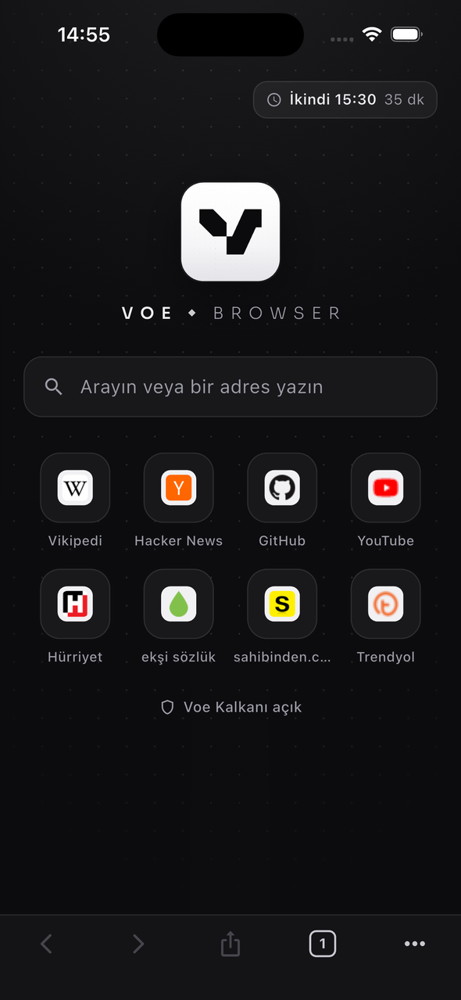
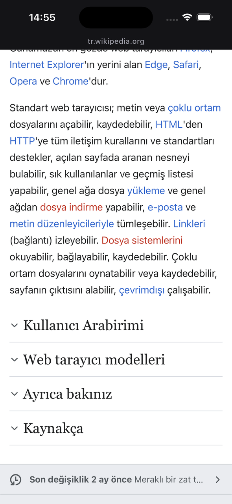
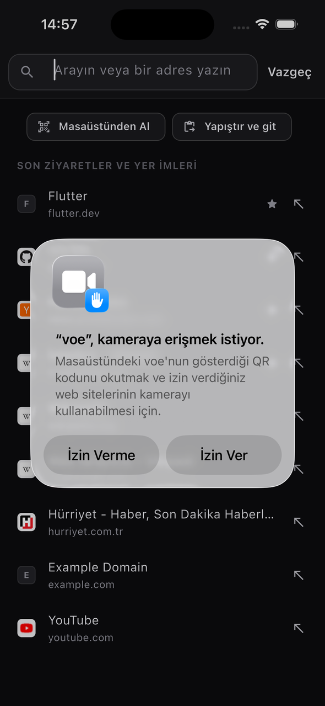
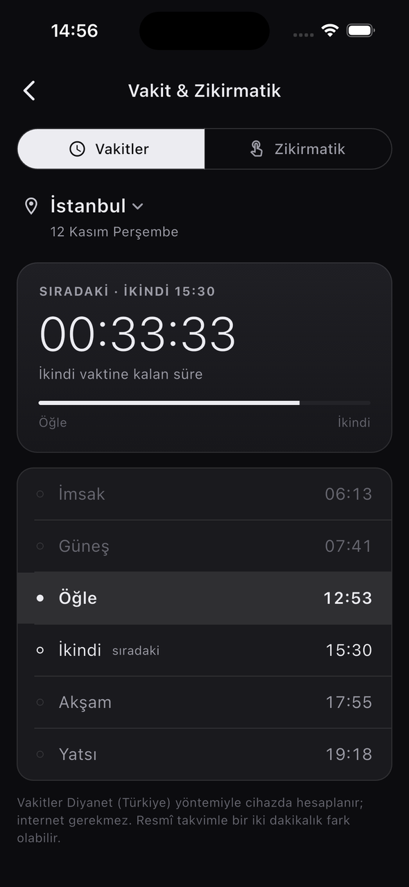

  

  <a href="README.md">Türkçe</a> · <b>English</b>

  
  
  
  
  

  <a href="https://github.com/dev-cagri/voe/releases/latest/download/voe-mac-arm64.dmg"><b>Download for macOS</b></a>
  &nbsp;·&nbsp; <a href="#voe-mobile">iOS (TestFlight)</a>
  &nbsp;·&nbsp; <a href="https://github.com/dev-cagri/voe/releases">All releases</a>
  &nbsp;·&nbsp; <a href="https://github.com/dev-cagri/voe/issues/new/choose">Feedback</a>

 

**voe** is a calm, fast, Chromium-based browser for macOS. It keeps everyday browsing quiet, and it puts the tools web developers reach for all day one click away inside the browser: device emulation, console errors, local dev servers, a JSON viewer and an offline toolbox. The **voe Shield** ad and tracker blocker is always on. The interface is in Turkish.

  

> [!NOTE]
> This repository hosts voe’s **releases, release notes and feedback**. voe is free; its source code is not public.

---

## For developers

<table>
  <tr>
    <td width="50%" valign="top">
      
      <h3>Developer panel <code>⇧⌘E</code></h3>
      The <code>&lt;/&gt;</code> button in the toolbar opens a panel for each tab. It lists the page’s console errors. It also shows the frameworks in use (React, Next.js, Vue, Svelte, Astro, Vite, Tailwind…), the server and hosting (Cloudflare, Vercel, Netlify…), the HTTP status and protocol, and a checklist of security headers (HSTS, CSP, frame protection, nosniff…).
    </td>
    <td width="50%" valign="top">
      
      <h3>Device and network emulation <code>⇧⌘M</code></h3>
      Switch to iPhone, Pixel or iPad in one click. The page view really shrinks to that width and is centred. The user agent, touch input and pixel ratio change too, and you can rotate the view. You can pick a light or dark color scheme, or Fast 3G, Slow 3G or offline networking. Switches turn off the cache or JavaScript, reduce motion, show the print view, outline every element, or let you edit the page in place. Everything is per tab and leaves no trace once turned off.
    </td>
  </tr>
  <tr>
    <td width="50%" valign="top">
      
      <h3>JSON viewer</h3>
      API responses open as a collapsible, searchable tree; even a 10 MB document appears instantly. Clicking a key copies its path (<code>data.items[3].name</code>). Big integers keep every digit, and the raw view is one click away.
    </td>
    <td width="50%" valign="top">
      
      <h3>Toolbox <code>⌥⌘T</code></h3>
      <code>voe://toolbox</code> has nine tools: format and validate JSON, decode JWTs, Base64, URL encoding and parsing, Unix timestamps, UUID v4/v7, hashes (SHA, MD5, HMAC), color conversion with WCAG contrast, and a regex tester. Everything runs offline; a pasted token never leaves the page.
    </td>
  </tr>
</table>

- **Local servers.** voe finds the dev servers running on your Mac on its own: Vite, Next.js, Nuxt, Astro, SvelteKit, Angular, Storybook, Django, Flask, FastAPI, Rails, Laravel, Express… It lists them with their page titles on the new tab page, in the address bar (type `local` or `:5173`) and in the command palette.
- **Test on your phone.** Press the QR button on a `localhost` page: the address is rewritten to your Mac’s LAN IP, so a phone on the same Wi-Fi opens it. If the server only listens on localhost, voe notices and shows the fix, such as `vite --host`.
- **Error count.** On local development pages, a red count appears on the `</>` button when the page throws JavaScript errors.
- **One-click cleanup.** “Clear site data” deletes the site’s cookies, storage and service workers, then reloads the page. A hard reload and the page source are one click away too.
- **Full Chromium DevTools** is always available with `⌥⌘I`.

## Privacy: what you look at is your business

On an ordinary browser, your internet provider and anyone on your network can see which sites you visit. voe closes that off by default:

- **Encrypted DNS (DNS-over-HTTPS).** Site names are looked up over an encrypted channel. **Strict mode** never falls back to plain DNS. You can pick Cloudflare, Quad9, Mullvad, AdGuard or your own server.
- **Encrypted site name (ECH).** On sites that support it, even the domain at the start of the secure connection stays hidden.
- **HTTPS first.** Addresses always open over an encrypted connection. If a site can’t do HTTPS, voe asks before continuing.
- **Your data is encrypted on disk.** History, bookmarks, the reading list, sessions and passwords are stored with AES-256-GCM, and the key lives in the macOS Keychain.
- **Tracker blocking, GPC and WebRTC protection.** voe Shield stops trackers. Sites receive a “don’t sell my data” signal, and your local IP address doesn’t leak.
- **Privacy check.** One button in Settings verifies all of this live.

## Sync: end-to-end encrypted, no account

Bookmarks (with folders), passwords, history, open tabs, the reading list and settings stay in sync between your Mac and your phone. There’s no account or email: scan the QR code on the desktop **Senkron** page with your phone.

Every record is encrypted on the device with **AES-256-GCM**. The server only sees meaningless encrypted blobs and can’t read URLs, titles or passwords. The key exists only on your devices. **Reset sync** cuts off a lost device in one step.

## For every day

| | |
|---|---|
| **voe Shield** | Blocks ads and trackers, hides cookie notices, can be turned off per site, stats on the new tab page |
| **Command palette** `⌘K` | Tabs, commands, bookmarks and history in one box; search ignores Turkish accents |
| **Tabs** | Live Chrome-style dragging (detach, merge into another window), colored tab groups, split view `⌥⌘S` |
| **Tab sleeping** | Unused tabs release their memory and come back exactly where they were |
| **Reading** | Reader mode `⌥⌘R` and an offline reading list `⇧⌘D` |
| **Focus session** | During a Pomodoro, distracting sites wait on a calm page |
| **Send to phone** | The page’s QR code is generated on your Mac; scan it with voe mobile or the camera |
| **Screenshots** | `⇧⌘2` visible area, `⌥⇧⌘2` full page |
| **Passwords** | Encrypted with the macOS Keychain, autofill, reveal with Touch ID |
| **Extensions** | Install from the Chrome Web Store |
| **Speed meter** | Page load time in the address bar, with a DNS-to-download breakdown |
| **Import from another browser** | Bookmarks, passwords, saved cards, addresses and history from Chrome, Edge, Brave, Vivaldi, Opera and Chromium in one step — everything stays on your device |
| **Vakit** | Time left until the next prayer, Hijri date and a tasbih counter (computed on device) |

## voe mobile

  
  
  
  

The iOS app is in **TestFlight** beta, and Android is on the way. It shares the same minimal design as the desktop app:
- The address bar is on top, and the toolbars slide away while you scroll.
- It has a tab grid and private tabs.
- voe Shield and reader mode are built in.
- “Masaüstünden Al” scans the QR code from the desktop “Send to phone” button and opens the page.

## Installation

1. Download **[voe-mac-arm64.dmg](https://github.com/dev-cagri/voe/releases/latest/download/voe-mac-arm64.dmg)**, open it and drag **voe** into **Applications**.
2. voe is signed with an Apple Developer ID and **notarized by Apple**; on first launch macOS only asks whether to open an app downloaded from the internet.
3. You can make voe your default browser in **Ayarlar → Varsayılan tarayıcı** (Settings → Default browser). Bookmarks, passwords, saved cards, addresses and history from Chrome, Edge, Brave and other browsers import in one step from **⋮ → Tarayıcıdan İçe Aktar…** (Import from browser); everything stays on your device.

**Requirements:** macOS 12 Monterey or later on Apple Silicon (M1 or newer).

## Updates

voe checks this repository’s [latest release](https://github.com/dev-cagri/voe/releases/latest) at launch and every 6 hours. The request carries only the app version. If a newer version exists, the ⋮ menu tells you; **İndir** (Download) saves the `.dmg` through voe’s own download manager. Nothing installs by itself. You can turn the check off in **Ayarlar → Güncellemeler** (Settings → Updates).

## Keyboard shortcuts

| Shortcut | Action | Shortcut | Action |
|---|---|---|---|
| `⌘K` | Command palette | `⇧⌘E` | Developer panel |
| `⌘L` | Address bar | `⇧⌘M` | Toggle iPhone emulation |
| `⇧⌘T` | Reopen closed tab | `⌥⌘T` | Toolbox |
| `⌥⌘S` | Split view | `⌥⌘I` | Chromium DevTools |
| `⇧⌘F` | Focus mode | `⌥⌘U` | View source |
| `⌥⌘R` | Reader mode | `⇧⌘R` | Reload ignoring cache |
| `⇧⌘D` | Add to reading list | `⇧⌘2` / `⌥⇧⌘2` | Screenshot / full page |

## Data and telemetry

- No telemetry: no usage statistics, crash reports or advertising IDs.
- Your data stays on your devices. With sync on, only end-to-end encrypted records reach the server.
- The local-server scan, Toolbox, JSON viewer and QR codes run entirely on your device.
- voe makes only three connections on its own: Shield filter-list updates, site icons for bookmarks, and the update check. The update check goes to GitHub, carries only the version and can be turned off.

## Feedback

Found a bug or have an idea? [Open an issue](https://github.com/dev-cagri/voe/issues/new/choose). For bugs, please include your voe version (**⋮ → voe Hakkında**) and macOS version. Issues in English are welcome.

## License

voe is free; its source code is not public. See [LICENSE](LICENSE) for details. voe builds on open-source projects, each under its own license: [Electron](https://www.electronjs.org/) and Chromium (MIT/BSD), [Ghostery adblocker](https://github.com/ghostery/adblocker) (MPL-2.0), [Mozilla Readability](https://github.com/mozilla/readability) (Apache-2.0), [electron-chrome-extensions](https://github.com/samuelmaddock/electron-browser-shell) (MIT), [adhan-js](https://github.com/batoulapps/adhan-js) (MIT), [qrcode-generator](https://github.com/kazuhikoarase/qrcode-generator) (MIT) and [Sora](https://github.com/sora-xor/sora-font) (OFL-1.1).

© 2026 voe

