

  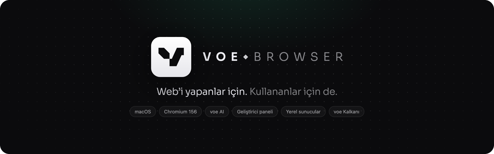

  <b>Türkçe</b> · <a href="README.en.md">English</a>

  
  
  
  
  

  <a href="https://github.com/dev-cagri/voe/releases/latest/download/voe-mac-arm64.dmg"><b>macOS için indir</b></a>
  &nbsp;·&nbsp; <a href="#voe-mobil">iOS (TestFlight)</a>
  &nbsp;·&nbsp; <a href="https://github.com/dev-cagri/voe/releases">Tüm sürümler</a>
  &nbsp;·&nbsp; <a href="https://github.com/dev-cagri/voe/issues/new/choose">Geri bildirim</a>

 

**voe**, Chromium tabanlı, sade ve hızlı bir macOS tarayıcısı. Günlük gezinmeyi sakinleştirir; web geliştirenlerin her gün açıp kapattığı araçları da tarayıcının içine, tek tıka koyar. Cihaz öykünmesi, konsol hataları, yerel sunucular, JSON görüntüleyici ve çevrimdışı bir araç kutusu hazır gelir. Reklam ve izleyici engelleyici **voe Kalkanı** her zaman açıktır. İstersen **voe AI** ile çeviri, özet ve sohbet de tamamen Mac’inde çalışır.

  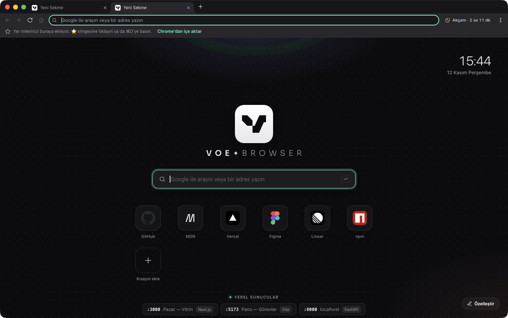

> [!NOTE]
> Bu depo voe’nun **sürümlerini, sürüm notlarını ve geri bildirimleri** barındırır. voe ücretsizdir; kaynak kodu açık değildir.

---

## Geliştiriciler için

<table>
  <tr>
    <td width="50%" valign="top">
      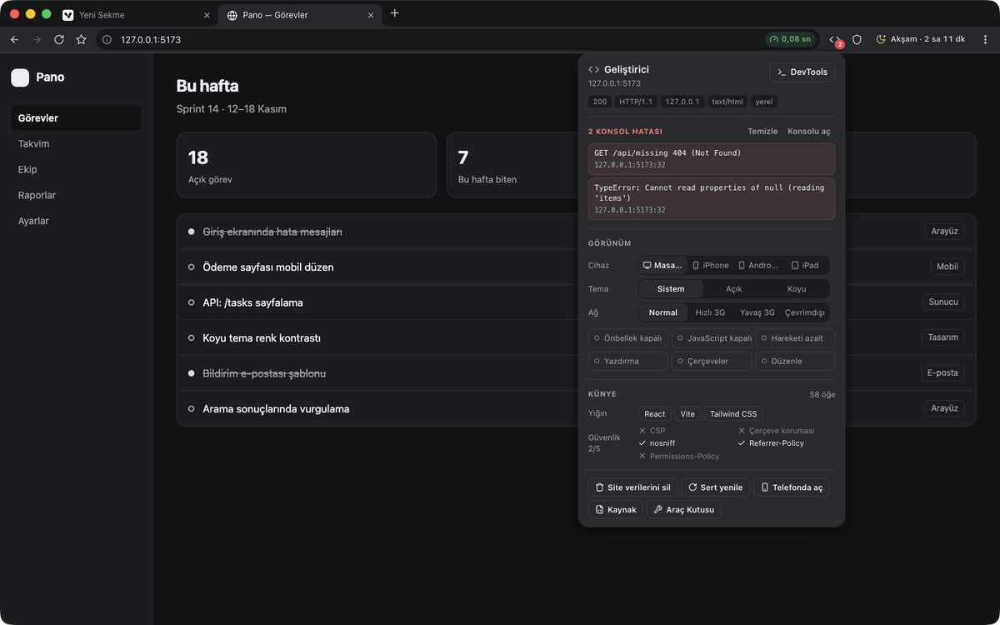
      <h3>Geliştirici paneli <code>⇧⌘E</code></h3>
      Araç çubuğundaki <code>&lt;/&gt;</code> düğmesi her sekme için bir panel açar. Sayfanın konsol hatalarını listeler. Kullanılan çatıları (React, Next.js, Vue, Svelte, Astro, Vite, Tailwind…), sunucuyu ve barındırmayı (Cloudflare, Vercel, Netlify…), HTTP durumunu, protokolü ve güvenlik başlıklarını (HSTS, CSP, çerçeve koruması, nosniff…) gösterir.
    </td>
    <td width="50%" valign="top">
      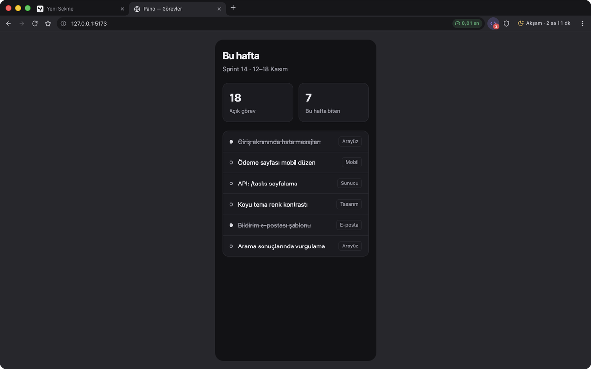
      <h3>Cihaz ve ağ öykünmesi <code>⇧⌘M</code></h3>
      Tek tıkla iPhone, Pixel ya da iPad. Sayfa gerçekten o genişliğe iner ve ortalanır. User-Agent, dokunma ve piksel oranı da değişir; istersen yatay çevirebilirsin. Açık ya da koyu tema, Hızlı 3G, Yavaş 3G ya da çevrimdışı ağ seçilebilir. Önbellek, JavaScript, “hareketi azalt”, yazdırma görünümü, öğe çerçeveleri ve sayfayı yerinde düzenleme anahtarlarla açılıp kapanır. Hepsi yalnızca o sekmeyi etkiler, kapatınca iz bırakmaz.
    </td>
  </tr>
  <tr>
    <td width="50%" valign="top">
      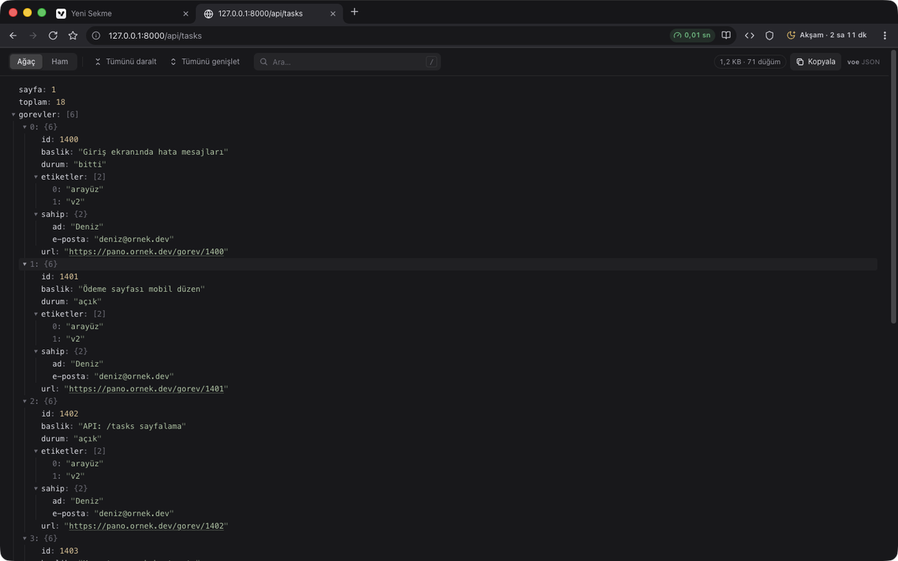
      <h3>JSON görüntüleyici</h3>
      API yanıtları katlanabilir, aranabilir bir ağaç olarak açılır; 10 MB’lık bir belge bile anında görünür. Bir anahtara tıklayınca yolu (<code>data.items[3].name</code>) kopyalanır. Büyük tam sayılar basamak kaybetmez ve “Ham” görünüme tek tıkla geçilir.
    </td>
    <td width="50%" valign="top">
      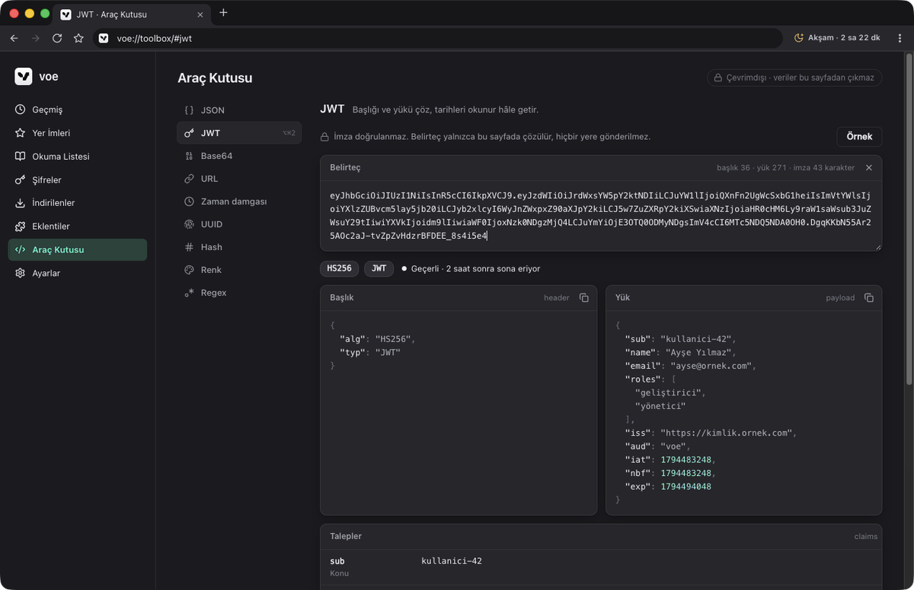
      <h3>Araç Kutusu <code>⌥⌘T</code></h3>
      <code>voe://toolbox</code> içinde dokuz araç var: JSON biçimlendirme ve doğrulama, JWT çözücü, Base64, URL kodlama ve ayrıştırma, Unix zaman damgası, UUID v4/v7, Hash (SHA, MD5, HMAC), renk dönüştürme ve WCAG kontrastı, Regex. Hepsi çevrimdışı çalışır; yapıştırdığın token sayfadan dışarı çıkmaz.
    </td>
  </tr>
</table>

- **Yerel sunucular.** voe, bu Mac’te çalışan geliştirme sunucularını kendiliğinden bulur: Vite, Next.js, Nuxt, Astro, SvelteKit, Angular, Storybook, Django, Flask, FastAPI, Rails, Laravel, Express… Bunları yeni sekmede, adres çubuğunda (`local` ya da `:5173` yazınca) ve komut paletinde sayfa başlıklarıyla gösterir.
- **Telefonda test et.** `localhost` sayfasında QR düğmesine bas: adres Mac’in yerel ağ IP’sine çevrilir, aynı Wi-Fi’deki telefon sayfayı açar. Sunucu yalnızca localhost’u dinliyorsa voe bunu fark eder ve `vite --host` gibi çözümü gösterir.
- **Hata sayacı.** Yerel geliştirme sayfalarında JavaScript hatası olunca `</>` düğmesinde kırmızı bir sayaç belirir.
- **Tek tıkla temizlik.** “Site verilerini sil” düğmesi o sitenin çerezlerini, depolamasını ve service worker’larını silip sayfayı yeniler. Sert yenileme ve sayfa kaynağı da bir tık uzakta.
- **Tam Chromium DevTools** her zaman `⌥⌘I` ile açılır.

## Gizlilik: neye baktığın yalnızca seni ilgilendirir

İnternet sağlayıcın ve aynı ağdakiler, sıradan bir tarayıcıda hangi sitelere girdiğini görebilir. voe bunu varsayılan olarak kapatır:

- **Şifreli DNS (DNS-over-HTTPS).** Açtığın sitelerin adları şifreli sorulur. **Katı mod** düz DNS’e hiç düşmez. Sağlayıcı olarak Cloudflare, Quad9, Mullvad, AdGuard ya da kendi sunucun seçilebilir.
- **Şifreli site adı (ECH).** Destekleyen sitelerde bağlandığın alan adı, şifreli bağlantının başında bile görünmez.
- **Önce HTTPS.** Adresler her zaman şifreli bağlantıyla açılır. Site desteklemiyorsa devam etmeden önce sorulur.
- **Verilerin cihazda şifreli.** Geçmiş, yer imleri, okuma listesi, oturum ve şifreler diskte AES-256-GCM ile saklanır; anahtar macOS Anahtar Zinciri’ndedir.
- **İzleyici engelleme, GPC ve WebRTC koruması.** voe Kalkanı izleyicileri durdurur. Sitelere “verimi satma” sinyali gider ve yerel IP adresin sızmaz.
- **Gizlilik denetimi.** Ayarlar’daki tek bir düğme hepsini canlı olarak doğrular.

## Senkron: uçtan uca şifreli, hesapsız

Yer imleri (klasörleriyle), şifreler, geçmiş, açık sekmeler, okuma listesi ve ayarlar **birden çok cihaz** arasında eşitlenir — telefon ve istediğin kadar Mac. Hesap ya da e-posta yoktur. İlk eşleştirmede bir cihazda **Senkron** sayfasındaki QR kodunu diğerinde okutursun: telefon kamerayla, yeni bir Mac ise Senkron → **Kamerayla tara** ile. Kamera kullanamıyorsan eşleştirme bağlantısını kopyalayıp yapıştırırsın.

Her kayıt cihazda **AES-256-GCM** ile şifrelenir. Sunucu yalnızca anlamsız şifreli blokları görür: URL, başlık ya da şifre göremez. Anahtar yalnızca senin cihazlarında durur. Kaybolan bir cihazın erişimini **Senkronu sıfırla** ile tek adımda kesebilirsin.

## voe AI: bu Mac’te çalışan yapay zekâ

  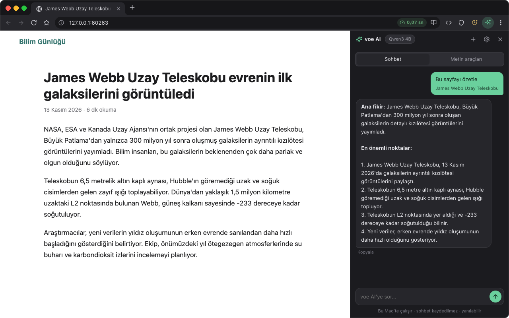

voe AI **isteğe bağlıdır**. Kurmadığın sürece hiçbir şey indirilmez. Kurulum, yeni sekmedeki voe AI kartından ya da araç çubuğundaki ✦ düğmesinden yapılır.

- **Yan panel** (`⌥⌘A` ya da ✦): sohbet et, **Bu sayfayı özetle** de, ardından sayfa hakkında soru sor. Metin araçlarıyla çevir, özetle, açıkla, yazımı düzelt.
- **Seçili metin** → sağ tık → **voe AI**: Türkçeye ya da İngilizceye çevir, özetle, açıkla, yazımı düzelt. Sonuç seçimin yanında akar. Düzenlenebilir alanlarda **Yerine yaz** ile tek tıkla değiştirirsin.
- **Tamamen cihazda.** Model ve motor ([WebLLM](https://github.com/mlc-ai/web-llm)) Mac’in GPU’sunda (WebGPU) çalışır. Yazdıkların, yanıtlar ve sayfa metinleri hiçbir sunucuya gitmez, kaydedilmez. İnternetten yalnızca model dosyaları bir kez, Hugging Face’teki MLC deposundan iner. Sonrasında internetsiz çalışır. Motor 5 dakika kullanılmazsa kapanır ve belleği boşaltır.
- **Modeller:** Qwen3 4B (önerilen, 2,3 GB, çalışırken ~3,4 GB bellek) ya da Gemma 2 2B (hafif, 1,5 GB). Panelin Model bölümünden değiştirilir ya da kaldırılır.
- Apple Silicon ve yaklaşık 4 GB boş disk ister. Küçük modeller yanılabilir; önemli bilgileri doğrula. İnternete erişimi olmadığı için güncel olayları bilmez.

## Her gün için

| | |
|---|---|
| **voe Kalkanı** | Reklam ve izleyici engelleme, çerez uyarılarını gizleme, site bazında kapatma, yeni sekmede istatistikler |
| **Komut paleti** `⌘K` | Sekmeler, komutlar, yer imleri ve geçmiş tek kutuda; Türkçe karakterlere duyarsız arama |
| **Sekmeler** | Chrome’daki gibi canlı sürükleme (ayır, başka pencereye birleştir), renkli sekme grupları, bölünmüş ekran `⌥⌘S` |
| **Sekme uyutma** | Kullanılmayan sekmelerin belleği boşaltılır; tıklayınca kaldığı yerden açılır |
| **Okuma** | Okuma modu `⌥⌘R` ve çevrimdışı okuma listesi `⇧⌘D` |
| **Odak oturumu** | Pomodoro süresince dikkat dağıtan siteler sakin bir sayfada bekletilir |
| **Telefona gönder** | Sayfanın QR kodu cihazda üretilir; voe mobil ya da kamera ile okut |
| **Ekran görüntüsü** | `⇧⌘2` görünür alan, `⌥⇧⌘2` tam sayfa |
| **Şifreler** | Anahtar Zinciri ile şifreli saklama, otomatik doldurma, Touch ID ile gösterme |
| **Eklentiler** | Chrome Web Mağazası’ndan kurulum |
| **Hız ölçer** | Adres çubuğunda sayfa yükleme süresi; DNS’ten indirmeye ayrıntılı döküm |
| **Yeni sekme kartları** | Piyasa, çok şehirli hava durumu, haberler (RSS), son depremler, namaz vakitleri, dünya saatleri, takvim, geri sayım, notlar, yapılacaklar, okuma listesi ve siteler; sürükleyerek sırala |
| **Tarayıcıdan içe aktar** | Chrome, Edge, Brave, Vivaldi, Opera ve Chromium’dan yer imleri, şifreler, kayıtlı kartlar, adresler ve geçmişi tek adımda — her şey cihazda kalır |
| **Vakit** | Sıradaki ezan vakti, hicri tarih ve zikirmatik (cihazda hesaplanır). Düğme dinamiktir: vakte bir saat kalınca geri sayım başlar. Ayarlar’dan kapatılabilir |
| **Web bildirimleri** | Siteler izin ister, kararın hatırlanır; bildirime tıklayınca sekmesi öne gelir |
| **İndirilenler** | Bitmiş dosyayı listeden Finder’a, masaüstüne ya da bir siteye sürükle |

## voe mobil

  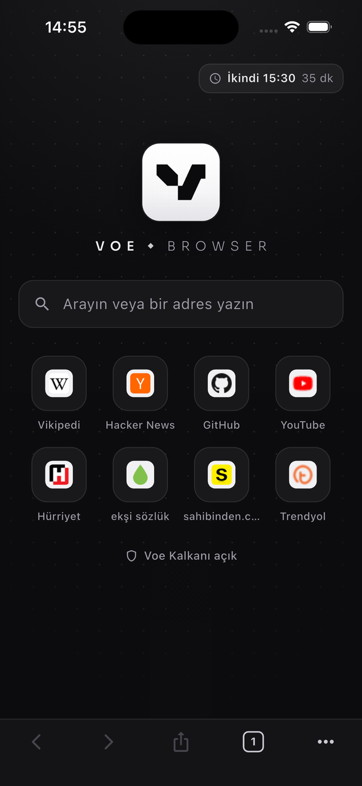
  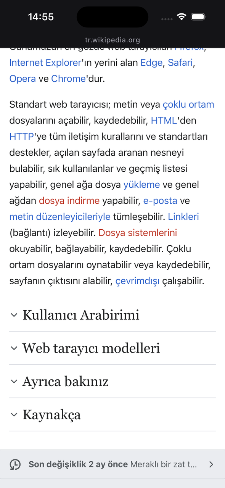
  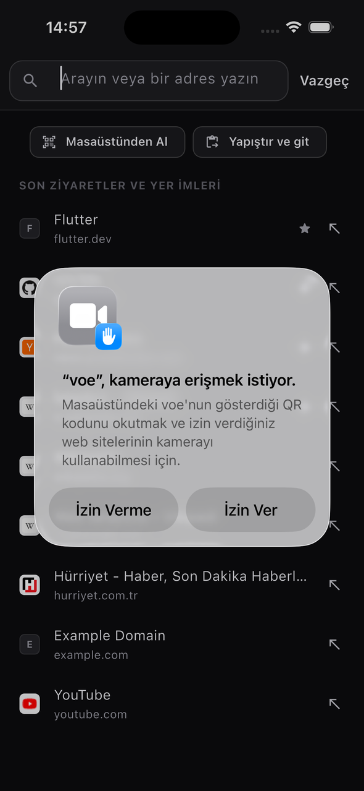
  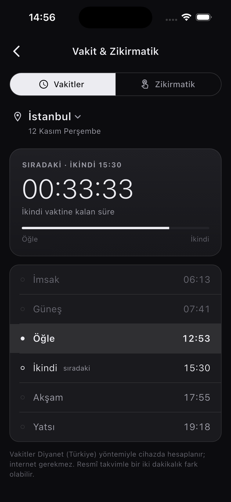

iOS sürümü **TestFlight** beta aşamasında, Android sürümü hazırlanıyor. Masaüstüyle aynı sade tasarımda gelir:
- Adres çubuğu üstte; kaydırınca araç çubukları çekilir.
- Sekme ızgarası ve gizli sekmeler var.
- voe Kalkanı ve okuma modu var.
- “Masaüstünden Al” ile masaüstündeki “Telefona Gönder” QR kodunu okutup sayfayı açabilirsin.

## Kurulum

1. **[voe-mac-arm64.dmg](https://github.com/dev-cagri/voe/releases/latest/download/voe-mac-arm64.dmg)** dosyasını indir, aç ve **voe**’yu **Uygulamalar** klasörüne sürükle.
2. voe, Apple’ın Developer ID imzasıyla imzalanmış ve Apple tarafından **notarize edilmiştir**; ilk açılışta yalnızca “internetten indirildi, açılsın mı?” sorusu çıkar.
3. İstersen **Ayarlar → Varsayılan tarayıcı** bölümünden voe’yu varsayılan tarayıcın yap. Chrome, Edge, Brave gibi tarayıcılardaki yer imlerini, şifreleri, kartları, adresleri ve geçmişi **⋮ → Tarayıcıdan İçe Aktar…** ile tek adımda taşıyabilirsin.

**Gereksinimler:** macOS 12 Monterey ya da üzeri, Apple Silicon (M1 ve sonrası).

## Güncellemeler

voe açılışta ve 6 saatte bir bu deponun [son sürümüne](https://github.com/dev-cagri/voe/releases/latest) bakar. İstek yalnızca uygulama sürümünü içerir.

0.2.11’den itibaren güncellemeler kendiliğinden kurulur. Yeni sürümün `.zip` paketi arka planda iner. GitHub’ın verdiği SHA-256 özetiyle doğrulanır, ardından macOS güncelleyicisi aynı geliştirici imzasını taşıdığını denetler. voe’yu yeniden başlattığında (ya da kapatıp açtığında) kurulur ve açık sekmelerin geri gelir. voe disk görüntüsünden ya da yazılamayan bir klasörden çalışıyorsa eskisi gibi `.dmg` indirmeyi önerir.

0.2.10 ve öncesinden geçerken bir kereliğine `.dmg` ile kurman gerekir. Otomatik indirme ve denetim **Ayarlar → Güncellemeler** bölümünden ayrı ayrı kapatılabilir.

## Klavye kısayolları

| Kısayol | Ne yapar | Kısayol | Ne yapar |
|---|---|---|---|
| `⌘K` | Komut paleti | `⇧⌘E` | Geliştirici paneli |
| `⌘L` | Adres çubuğu | `⇧⌘M` | iPhone öykünmesi aç/kapat |
| `⇧⌘T` | Kapatılan sekmeyi geri aç | `⌥⌘T` | Araç Kutusu |
| `⌥⌘S` | Bölünmüş ekran | `⌥⌘I` | Chromium DevTools |
| `⇧⌘F` | Odak modu | `⌥⌘U` | Sayfa kaynağı |
| `⌥⌘R` | Okuma modu | `⇧⌘R` | Önbelleği atlayarak yenile |
| `⇧⌘D` | Okuma listesine ekle | `⇧⌘2` / `⌥⇧⌘2` | Ekran görüntüsü / tam sayfa |
| `⌥⌘A` | voe AI paneli | | |

## Veri ve telemetri

- Telemetri yok: kullanım istatistiği, çökme raporu ya da reklam kimliği toplanmaz.
- Veriler yalnızca cihazlarında durur. Senkron açıksa sunucuya yalnızca uçtan uca şifreli kayıtlar gider.
- Yerel sunucu taraması, Araç Kutusu, JSON görüntüleyici, QR kodları ve voe AI tamamen cihazda çalışır.
- voe kendiliğinden yalnızca üç bağlantı kurar: Kalkan filtre listelerinin güncellenmesi, yer imlerinin site simgeleri ve güncelleme denetimi. Güncelleme denetimi GitHub’a gider, yalnızca sürüm bilgisini içerir ve kapatılabilir. Yeni sürüm varsa paketi de GitHub’dan iner. voe AI’yi kurarsan model dosyaları bir kez Hugging Face’ten iner; yazdıkların hiçbir yere gönderilmez.

## Geri bildirim

Hata mı buldun, bir fikrin mi var? [Yeni bir kayıt aç](https://github.com/dev-cagri/voe/issues/new/choose). Hata bildirirken voe sürümünü (**⋮ → voe Hakkında**) ve macOS sürümünü yazman yeterli.

## Lisans

voe ücretsizdir; kaynak kodu açık değildir. Ayrıntılar için [LICENSE](LICENSE) dosyasına bak. voe; [Electron](https://www.electronjs.org/) ve Chromium (MIT/BSD), [Ghostery adblocker](https://github.com/ghostery/adblocker) (MPL-2.0), [Mozilla Readability](https://github.com/mozilla/readability) (Apache-2.0), [electron-chrome-extensions](https://github.com/samuelmaddock/electron-browser-shell) (MIT), [adhan-js](https://github.com/batoulapps/adhan-js) (MIT), [qrcode-generator](https://github.com/kazuhikoarase/qrcode-generator) (MIT), [WebLLM](https://github.com/mlc-ai/web-llm) (Apache-2.0) ve [Sora](https://github.com/sora-xor/sora-font) (OFL-1.1) gibi açık kaynak projelere dayanır; bu projelerin lisansları kendi koşullarıyla geçerlidir. voe AI modelleri ayrıca indirilir: [Qwen3](https://huggingface.co/Qwen/Qwen3-4B) (Apache-2.0), [Gemma 2](https://ai.google.dev/gemma/terms) (Gemma Kullanım Koşulları).

© 2026 voe

